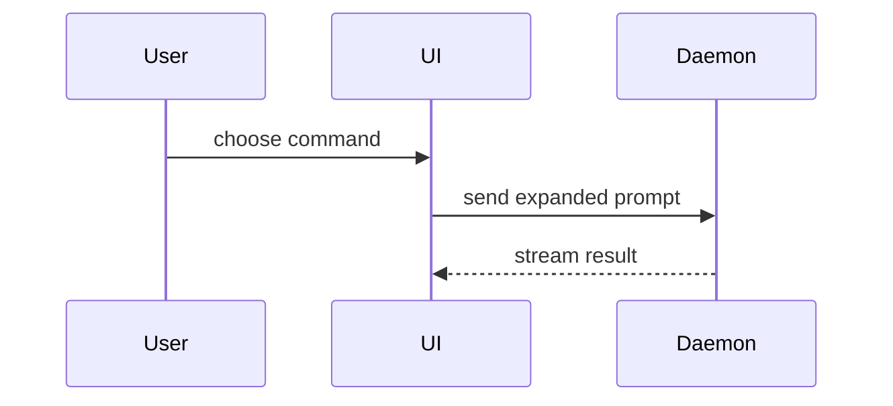

Use this template for writing the PR body:

```markdown
## Summary

<diagram, before/after sketch, or tree>

## Evidence

- **Before:** <screenshot/output/failing test run>
  **After:** <screenshot/output/passing test run>

## Merge Danger

**Door:** <one-way or two-way>

<optional: description>

**Blast Radius:** <one-word description>

<optional: potential ramifications of merge>
```

## Sections

Skip all preambles and keep prose brief. Use the user's domain language from `GLOSSARY.md`.

### Summary

Pick the smallest view that makes the key point clear.

- Show logic or an algorithm as pseudocode:

```text
on(save)
  if content is unchanged
    return cached result
  write new content
  return fresh result
```

- Show runtime control flow as a call tree:

```text
submitForm
  createSession
    persistPrompt
    launchAgent
  navigateToSession
```

- Show UI structure as a component tree, including state and module boundaries that matter:

```text
<SessionPage> (apps/example/src/routes/session.tsx)
  useSessionEvents()
  <SessionToolbar>
    <RunSkillButton> (packages/ui)
```

- Show file responsibility or a broad refactor as a shallow file tree:

```text
src/
├── commands/       # parses user actions
├── sessions/       # owns session state
└── transport/      # sends API requests
```

- Show component interaction, control flow, or data flow with Mermaid:



- When the point is what changes, draw a plain-text BEFORE / AFTER sketch in a `text` block. Don't use `diff` blocks with `+`/`-` lines. Use boxes, arrows (`──►`, `→`) and brackets (`┐ ┼ ┘`) to show the shape. Label each half with one line that names the change, and end with one-line notes for side effects:

```text
BEFORE: three copies of the device steps

  DFPRunner::init_local  (local)   ──► own open, load, start, stop, close
  DFPExecutor            (shared)  ──► own open, load, start, stop, close
  AutoClocker::run(id)             ──► own open, load, start, stop, close

AFTER: one copy

  DFPRunner::init_local  (local)   ──┐
  DFPExecutor            (shared)  ──┼──► MxDevice
  AutoClocker::run(dev)            ──┘    open → load → start → stop → close

  init_local fails   → fail_init_local() closes devices opened earlier
  AutoClocker error  → closes dev before returning
```

Use the same BEFORE / AFTER shape for component trees, file layouts, call trees and control flow. Keep it under about 15 lines and 80 characters wide.

- Show the whole block when most of it is new, when omitted context would hide ownership or order, or when the user needs a copyable target shape:

```ts
function expandSkill(command: string): string {
  const skillName = command.slice(1);
  return `use the ${skillName} skill`;
}
```

#### Guidance

Place each visual next to the short text it supports. Keep only the calls, files, props, states, and boundaries needed to answer the user's current question or the options to resolve the current discussion point.

You may use one of these, you may use several, it is unlikely you will use all of them. Use your judgement and don't overwhelm the user.

### Evidence

Concrete evidence that the change works. Show a before and after.

Screenshots are S-tier - when the environment is set up for it and the change is visual.

Execution-based evidence is A-tier. Test results, console output. Show the exact test that now fails and passes, using pseudocode.

### Merge Danger

Describe whether it's a one-way or two-way door. You can walk back through two-way doors, but not one-way doors. A PR that is cheap to roll back is lower risk. Changes that involve destructive actions or hard-to-reverse decisions are one-way doors.

The blast radius is the potential impact or scope of the changes introduced by this PR. Consider all possibilities. Examples are layout shift, breakages for consumers, mobile responsiveness, etc.
